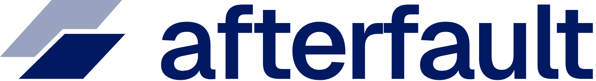

  <a href="https://afterfault.com/">
    <picture>
      <source media="(prefers-color-scheme: dark)" srcset=".github/assets/afterfault-lockup-dark.png" />
      
    </picture>
  </a>

<strong>Simulation infrastructure for the next generation of intelligent systems.</strong>

  <a href="https://afterfault.com/">Website</a> ·
  <a href="https://afterfault.com/research/">Research</a> ·
  <a href="https://afterfault.com/blog/">Blog</a> ·
  <a href="https://afterfault.com/#access">Early access</a>

---

Afterfault builds environments where software, and the agents that write it, meet the real
world's failures before the real world does. We take the systems you already run, rebuild them in
an isolated sandbox, put them through crashes, stalls and lost connections on purpose, and report
what actually happened.

## Why we exist

AI now writes software faster than anyone can check it. Coding agents open changes all day, and
the tests on each change are usually written by the same agent. Those tests pass in a healthy
environment, while the failures that cost the most stay hidden until something goes wrong in
production: a customer charged twice, a message that never arrives, data that was saved and then
is gone.

Those failures appear when the world misbehaves: a process dies halfway through its work, the
network stalls, a retry lands twice, the power goes out. Testing for them has meant rare,
expensive exercises run by specialists, or a rewrite of the system onto someone else's platform.
We think every change deserves that check, automatically, before it merges.

## Our mission

To make it possible to trust what intelligent systems do, by letting them meet the world's failures
in simulation first.

Software is the first kind of system we work on. It is not the last.

## What we do

**Agents build the environment.** Point Afterfault at the software you already run (compose
files, Kubernetes manifests, start scripts) and its agents work out how the system fits together
and build a working copy of it. There is nothing to rewrite and no new platform to adopt. It asks
only about what it cannot work out on its own.

**The environment is a sandbox.** Every run happens in an isolated, disposable copy of the real
system, with its services, databases and queues. Nothing live is touched, so anything can be
broken.

**We simulate what goes wrong.** Afterfault runs the system through the failures that break real
systems, hundreds of times, in different orders and at different moments, and searches for the
ones that matter.

**We check the outcome, not the report.** Software can say "finished" and be wrong. Our checks
look at what actually arrived, what was saved and what a customer would see, and never take the
system's word for it.

**Failures become tests.** When something breaks, you get the exact sequence of events that broke
it, cut down to the steps that matter. That run is kept and replayed on every later change, so the
same failure cannot come back quietly.

## What we provide

- **Environments:** working copies of real systems, built by agents from the files a team already
  has.
- **Sandboxes:** isolated, disposable runs where anything can fail and nothing live is at risk.
- **Failure simulation:** process crashes and kills, pauses, network partitions, power loss and
  disk corruption, combined and timed on purpose.
- **Recorded runs:** every run recorded step by step, so a failure can be read, shared and
  replayed exactly.
- **Regression protection:** a failure found once stays as a test on every change after it.
- **Comparisons:** two versions or two settings of a system under the same failures, with the
  difference counted.
- **Incident reproduction:** traces, logs or a postmortem in; the sequence of failures that
  reproduces the incident out.
- **Agent access:** coding agents call Afterfault themselves, over MCP, to test their own change
  before anyone reviews it. Engineers use the command line.

## Where we start

Our first product is for engineering teams whose AI coding agents ship changes every day. It sits
**before the pull request**: an agent or an engineer checks a change against real failures where
it is written, so CI spends its time on changes that already hold, and a red result arrives with
the reason attached.

The verdict comes from the environment, not from the agent that wrote the change.

## Where we are going

The same approach reaches further than software services:

- **Environments for AI agents**, where agents are tested before they act on live systems.
- **The software around robot fleets**, connected to the physics simulators teams already use.
- **Experience for learning systems**: every recorded run is data about how a system behaves when
  the world goes wrong.

That is what we mean by simulation infrastructure for the next generation of intelligent
systems.

## How we work

- **Your real system, not a model of it.** We start from the software you already run.
- **What happened, not what was reported.** Every check looks at the outcome itself.
- **Built for agents as well as engineers.** Agents run it the same way engineers do.
- **We publish what we find.** Our results on real open-source software are written up in full,
  with what they show and what they do not: [afterfault.com/research](https://afterfault.com/research/).

## Get in touch

Afterfault is in early access. If you have a system you need to trust, tell us what it runs on and
which failure worries you most.

- Early access: [afterfault.com/#access](https://afterfault.com/#access)
- Email: [yashas@afterfault.com](mailto:yashas@afterfault.com)
- X: [@afterfault_ai](https://x.com/afterfault_ai)
- LinkedIn: [Afterfault](https://www.linkedin.com/company/afterfault-ai)

Afterfault is based in San Francisco, CA.
